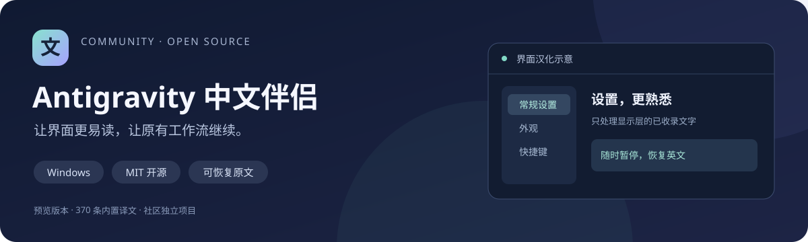

# Antigravity 中文伴侣



为 Windows 版 Antigravity 提供可随时恢复的简体中文界面。独立运行，免安装，不修改客户端安装文件。

> 当前是 v0.1.0 预览版，实测客户端版本为 **Antigravity 2.29.0**，内置 **370 条译文**。尚未实现完整汉化，也未承诺兼容所有后续版本。

[快速开始](#下载与使用) · [实现原理](docs/架构说明.md) · [兼容与排错](docs/兼容与排错.md) · [贡献指南](CONTRIBUTING.md) · [更新日志](CHANGELOG.md) · [安全政策](SECURITY.md)

## 项目特点

| 特点 | 当前实现 |
| --- | --- |
| 独立运行 | 本机托盘伴侣，不替换客户端安装资源 |
| 可逆显示 | 支持暂停、恢复原文和正常退出清理 |
| 离线词典 | 内置人工整理的简体中文词条，无在线翻译调用 |
| 内容保护 | 按界面区域与内容类型限制处理范围 |
| 开放构建 | MIT 源码、自动测试、Windows 构建与版本校验文件 |

## 下载与使用

在本仓库页面打开 **Releases（发行版）**，下载 Windows ZIP 并完整解压。

1. 正常打开 Antigravity。
2. 双击 `Antigravity中文伴侣.exe`，等待约 2～4 秒。
3. 右下角托盘图标可查看状态、暂停汉化或恢复英文。图标可能收起在“显示隐藏的图标”中。
4. 退出时选择托盘菜单的“恢复英文并退出”，或者运行 `恢复英文并退出.exe`。

也可先启动伴侣，再启动客户端。伴侣不会添加开机启动，不会替你启动或重启 Antigravity。运行程序不需要 Node.js、Python 或管理员权限；需要支持 .NET Framework 4.5 及以上的 Windows 环境，推荐 Windows 10/11。

## 汉化范围

- 主要菜单、侧栏和部分弹出菜单。
- 设置分类、常规设置及说明、外观、快捷键、通知、应用设置、模型与额度等已收录词条。
- 通过监听页面更新，处理允许区域内后续出现的文字。

用户输入、代码块、终端、快捷键按键、项目条目、技能正文等设有跳过规则。品牌、模型名称和命令标识保留原样。Windows 原生弹窗、第三方插件、部分动态标签和未收录文字仍可能显示英文。用户内容与界面区域的区分依赖当前客户端结构，若发现误译，请恢复英文并提交复现信息。

## 工作原理与边界

伴侣读取 Antigravity 已有的 `DevToolsActivePort`，仅连接 `127.0.0.1` 上的本地接口，在隔离的 JavaScript 上下文中替换允许区域的文本节点及提示属性。

程序不修改安装包、启动参数、输入值、参数值或事件处理程序。不会主动打开调试端口，也不调用在线翻译或上传界面内容。汉化属于运行时显示修改，不能作为修改权限、模型或命令行为的方式。

正常退出会恢复受管理的原文并移除当前连接的初始化脚本。若强制结束程序，当前页面中的汉化可能暂时保留；重新运行伴侣，再正常恢复英文即可。遇到连接失败或显示异常，可以先恢复英文。客户端更新后可能需要调整选择器和词典。

这是社区独立项目，与 Google 或 Antigravity 官方无隶属或背书关系。仓库仅包含伴侣源码及人工整理的译文，不包含 Antigravity 客户端或其原始资源。

## 从源码构建

Windows 中使用 PowerShell 执行：

```powershell
.\build.ps1
```

默认输出到 `dist/Antigravity中文伴侣/`，包括两个 EXE、使用说明和许可证。脚本使用 Windows 的 .NET Framework C# 编译器，构建过程不需要下载依赖。

项目结构：

```text
src/         托盘程序、恢复工具、显示脚本及词典
tests/       独立浏览器中的行为测试
build.ps1    Windows 构建入口
LICENSE      MIT 开源许可证
```

## 测试

开发测试需要 Node.js 20+：

```sh
npm ci
npx playwright install chromium
npm test
```

也可通过 `AGZH_BROWSER_CHANNEL=chrome` 使用已经安装的 Chrome。运行测试不会连接你的 Antigravity，而是使用独立的测试页面。

测试覆盖静态和动态汉化、输入及代码保护、原参数值与按钮事件保持、重复注入、外部文字更新、节点移除、恢复英文、断开调试会话后的清理。实机已确认 2.29.0 主界面及常规设置汉化和恢复；尚未完成所有页面的视觉验收或完整业务回归。

## 贡献译文

修改 `src/dictionary.json`，键为准确的英文原文，值为简体中文。保持 JSON 合法，避免重复键，并运行测试。

个人使用时，也可将完整词典保存为 EXE 同目录下的 `汉化词典.json`；该文件会替代内置词典，重启伴侣生效。新增词条仍只作用于已允许汉化的界面区域。

欢迎通过 Issues 报告漏译或兼容问题，通过 Pull Request 补充译文。请提供客户端版本、页面名称和复现步骤，并去除截图中的个人信息。

## 发布

`main` 分支及 Pull Request 会触发测试和 Windows 构建。推送 `v*` 版本标签会调用同一套检查，检查通过后创建预览版 Release，上传 ZIP 和 SHA-256 校验文件。下载包中的 EXE 由 GitHub Actions 从该标签指向的公开源码编译。

发布下一版时同步更新 `version.txt`、`package.json`、`package-lock.json`、`CHANGELOG.md` 和 `RELEASE_NOTES.md`，完成检查后再推送对应标签。流程不会覆盖已发布版本的文件。具体流程见 [发布说明](docs/发布说明.md)。

## 路线图

- [ ] 扩充未覆盖的动态标签和常用弹窗。
- [ ] 增加客户端新版本的兼容记录。
- [ ] 补充多窗口、密集更新和更多界面结构的测试。
- [ ] 完成主要页面的人工视觉验收。

项目当前没有承诺更新时间；欢迎提交可复现的问题和小范围改进。

## 许可证

[MIT](LICENSE)，允许使用、修改和再分发，请保留许可证声明。
