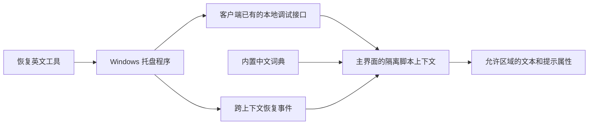

# 架构说明

## 组件

- `ChineseCompanion.cs`：托盘菜单、单实例控制、客户端发现、CDP 通信和退出清理。
- `StopCompanion.cs`：通过本机命名事件请求运行中的伴侣正常退出。
- `ui-translator.js`：允许区域、内容跳过规则、动态监听、文字记录与恢复。
- `dictionary.json`：英文原文到简体中文的精确匹配词典。

## 生命周期

1. 从当前用户的应用数据目录读取客户端已有的调试端口文件。
2. 枚举页面，限制本地地址与 WebSocket 地址，并在脚本中检查主界面标识。
3. 清理遗留汉化脚本，为新文档注册初始化脚本，在当前主界面安装显示逻辑。
4. 用 `MutationObserver` 合并处理允许区域中的新增内容及文字更新。
5. 暂停或退出时，移除初始化脚本，并发送跨隔离上下文的恢复事件。

恢复过程只还原仍等于伴侣译文的文字，避免覆盖客户端后来写入的新内容。用户输入值、参数值、业务事件与节点结构不属于修改对象。

## 边界与维护

这是面向特定客户端结构的适配器，不是官方语言包。区域选择器、词条和内容保护规则都需要随客户端演进维护。精确文本匹配也存在歧义；添加区域时必须同时考虑用户内容的识别与跳过。

正常退出与强制终止不同：后者可能保留页面中的脚本。重新启动伴侣后会尝试清理遗留脚本；恢复事件可跨断开的调试会话工作。

默认不记录诊断日志。开发者可以通过 `AGZH_TRACE` 指定本机诊断文件；这类文件不得加入公开问题、仓库或发布包，除非已完成脱敏。

## 验证方式

回归测试在独立页面验证显示逻辑和恢复事件，不依赖正在运行的客户端。Windows CI 验证编译与打包。真实页面的布局、业务流程和新版本兼容性仍需人工验证。
